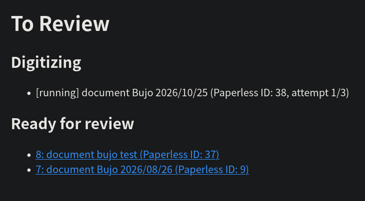
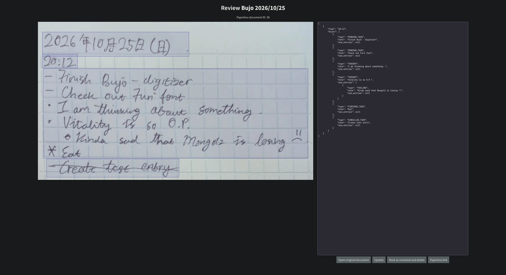
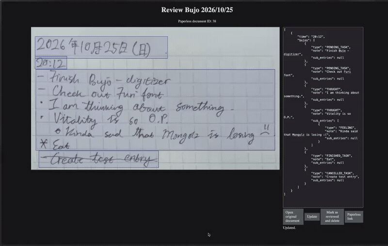

# Bujo Digitizer

A small FastAPI service that turns scanned bullet-journal pages in
[Paperless-ngx](https://github.com/paperless-ngx/paperless-ngx) into structured
Markdown.

Serves an API to be called by a Paperless-NGX workflow when a document is
added. The service downloads the PDF, rasterizes each page, runs OCR and a
parsing prompt through an OpenAI-compatible API, and stores the result for
review in a small web UI. When a review is approved, the generated Markdown is
written back to Paperless and, optionally, merged into the matching daily note
in an Obsidian vault.

## How it works

1. Set up a Paperless-NGX workflow which hits the `POST /digitize/webhook`
   API.
2. The API will queue it as an async job in SQLite.
3. A background worker will take the job, download the PDF, render pages to
   images (because llama.cpp does not support PDFs just yet), and call the OCR
   and parser models.
4. Results wait under `/reviews` for a human to inspect and edit.
5. Approving a review updates the Paperless document content and tags it. If
   Obsidian is enabled, the entries are merged into the configured bullet
   journal section of that day's note.

## UI

### Review list UI



### Review UI



### Updating the bujo



## Dependencies

- Python 3.14+
- [uv](https://docs.astral.sh/uv/) for dependency management
- Runtime libraries (declared in `pyproject.toml`): FastAPI, Uvicorn, httpx2,
  Jinja2, OpenAI SDK, Pydantic / pydantic-settings, BeautifulSoup, Pillow,
  pypdfium2, python-multipart, and yoyo-migrations
- An OpenAI-compatible chat/responses endpoint for the OCR and parser models
- A reachable Paperless-ngx instance and API token
- Optional: an Obsidian vault directory mounted into the container

## Setup

```sh
git clone <repository-url>
cd bujo-digitizer

# Install runtime and development dependencies
make deps

# Create the environment file and fill in the values
cp .env.example .env
$EDITOR .env
```

Core `.env` values:

| Variable | Purpose |
| --- | --- |
| `OPENAI_BASE_URL` | Base URL of the OpenAI-compatible API |
| `OPENAI_API_KEY` | API key for that endpoint; defaults to `a` for keyless local OpenAI-compatible servers |
| `PAPERLESS_BASE_URL` | Paperless-ngx base URL |
| `PAPERLESS_TOKEN` | Paperless API token |
| `PAPERLESS_DIGITIZED_TAG_ID` | Id of the Paperless tag applied when a review is approved |

Useful optional values are documented in `.env.example` (`SQLITE_PATH`, worker
concurrency/polling, `OBSIDIAN_BUJO_ENABLED`,
`OBSIDIAN_VAULT_PATH`, and the note template). Model defaults live in
`config.py`; override them with `OCR_MODEL`, `OCR_TEMPERATURE`,
`OCR_REASONING_BUDGET_TOKENS`, `PARSER_MODEL`, `PARSER_TEMPERATURE`, and
`PARSER_REASONING_BUDGET_TOKENS`.

## Database migrations

Schema changes are migration files under `src/bujo_digitizer/migrations/`, managed by
[yoyo-migrations](https://pypi.org/project/yoyo-migrations/). `yoyo.ini` points
at that folder and the default SQLite database.

Migrations are applied automatically on startup, but the CLI can be used
directly during development:

```sh
# Create a new timestamped SQL migration
make migration-new

# Apply pending migrations
make migrate

# Show applied and pending migrations
make migration-ls
```

An existing database is adopted as the migration baseline, and a follow-up
migration adds any columns missing from older schemas, so no manual baseline is
needed. The `make` targets pass `SQLITE_PATH` through `--database`, so they
follow a customized database path automatically.

## Run

```sh
# listens on 127.0.0.1
make dev
```

or

```sh
# listens on 0.0.0.0
make dev-open
```

The service listens on `http://0.0.0.0:8000` or `http://127.0.0.1:8000`
depending whether `make dev` or `make dev-open`. Open `/` for the review list or
`/docs` for the generated API documentation.

Point a Paperless webhook at `POST http://<host>:8000/digitize/webhook` with a
JSON body containing `doc_id`, `doc_title`, and optionally `created`.

## Test

```sh
make test
```

The tests use temporary SQLite databases and fake OpenAI/Paperless clients, so
they do not need network access or real credentials.

## Build

Build the Python package:

```sh
make build
```

Build and run the container:

```sh
docker build -t bujo-digitizer .
docker run --rm -p 8000:8000 --env-file .env bujo-digitizer
```
